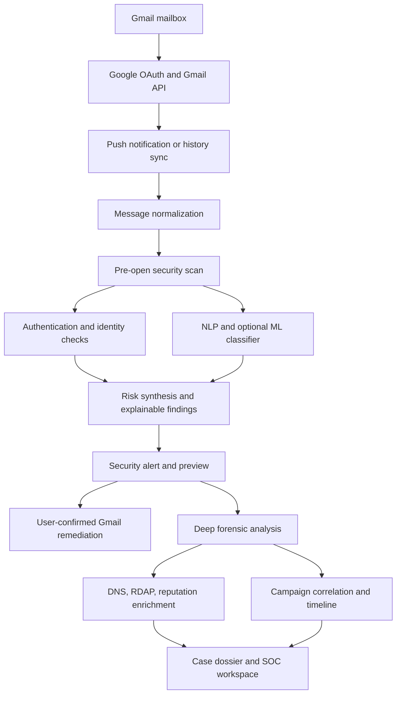

# MAILTRACE AI

> **Pre-open email threat detection · Explainable security intelligence · Digital forensics**

MAILTRACE AI is an email-security and digital-forensics platform designed to help users inspect suspicious messages before interacting with them. It combines Gmail integration, pre-open threat scanning, email-authentication analysis, machine-learning/NLP signals, threat-intelligence enrichment, campaign correlation, and case-based investigation.

The project has two connected workflows:

- **User protection:** a security inbox and pre-open preview that explain risk signals and offer user-confirmed Gmail actions.
- **SOC investigation:** a case-oriented forensic workflow for message headers, authentication results, infrastructure indicators, and potential campaign relationships.

> **Security notice:** MAILTRACE is decision-support software, not a guarantee that an email is safe or malicious. Model outputs, authentication results, reputation feeds, and geolocation must be interpreted in context. Do not use a single score as the sole basis for high-impact security decisions.

---

## Capabilities

| Area | Functionality |
|---|---|
| Pre-open scanning | Builds a security preview and risk assessment before a user chooses to open a message. |
| Gmail integration | OAuth-based mailbox connection, message synchronization, history tracking, and push-notification support. |
| Email authentication | SPF, DKIM, DMARC, and alignment evidence. |
| Header forensics | RFC 822/5322 parsing, received-hop extraction, and sender/header analysis. |
| AI/NLP intelligence | Intent and entity extraction plus optional transformer-based classification. |
| Threat enrichment | DNS, RDAP, reputation, and approximate IP/network context where supported and configured. |
| Campaign correlation | Links related incidents using shared infrastructure and semantic signals. |
| Remediation | User-confirmed Gmail actions such as reporting spam, blocking a sender, or moving a message to Trash. |
| Case management | Links alerts, analysis results, and investigation records. |

## Architecture



## Repository structure

```text
.
├── backend/         # FastAPI API, Gmail integration, persistence, services, tests
├── frontend/        # React Native / Expo client for web and mobile
├── forensics/       # Email parsing, authentication, and header analysis
├── intelligence/    # DNS, RDAP, reputation, and GeoIP enrichment
├── graph/           # Campaign correlation and incident timelines
├── ml/              # Inference code, model metadata, checkpoint location
├── docs/            # Architecture, workflows, and feature guides
├── explainability/  # Explainability-related components
├── data/            # Safe sample-data location; do not add private mailbox data
├── .env.example     # Local backend configuration template
└── README.md
```

## Getting started

### Prerequisites

- Python **3.11+**
- Node.js compatible with the Expo SDK in `frontend/package.json`
- npm and Git
- A Google Cloud project and OAuth client only when connecting a real Gmail account
- Optional model checkpoint assets for transformer inference

### 1. Clone the repository and create a virtual environment

```bash
git clone https://github.com/hrsubhut/MAILTRACE.git
cd MAILTRACE

python -m venv .venv

# macOS / Linux
source .venv/bin/activate

# Windows PowerShell
.venv\Scripts\Activate.ps1
```

### 2. Configure the backend

```bash
cp .env.example .env
# Windows PowerShell: Copy-Item .env.example .env

python -m pip install --upgrade pip
pip install -r backend/requirements.txt
pip install -r backend/requirements-dev.txt
```

Edit `.env` locally. Use a strong, unique `SECRET_KEY` for non-development environments. Keep real Google OAuth credentials and tokens out of source control.

### 3. Start the backend

From the repository root:

```bash
uvicorn backend.app.main:app --host 127.0.0.1 --port 8000 --reload
```

Useful local endpoints:

- API root: [http://127.0.0.1:8000/](http://127.0.0.1:8000/)
- Swagger / OpenAPI UI: [http://127.0.0.1:8000/docs](http://127.0.0.1:8000/docs)
- ReDoc: [http://127.0.0.1:8000/redoc](http://127.0.0.1:8000/redoc)

The application has fallback behavior when optional transformer weights are unavailable. Confirm model readiness from the application's health/diagnostic output and backend logs; do not assume a model is active merely because the API starts.

### 4. Start the frontend

Open a second terminal:

```bash
cd frontend
npm ci
npm run web
```

For Android/iOS development, run `npm start` and select the target in the Expo developer interface.

For a physical phone, set `EXPO_PUBLIC_API_URL` in `frontend/.env` to the development computer's LAN IP address. `127.0.0.1` on a phone refers to the phone itself, not the computer. Use a trusted private network and do not expose a development server publicly without proper authentication and HTTPS.

## Configuration reference

The backend reads values from the root `.env`. The frontend has a separate template at [`frontend/.env.example`](frontend/.env.example).

| Variable | Purpose |
|---|---|
| `APP_ENV` | Runtime environment, such as `development` or `production`. |
| `SECRET_KEY` | Application signing/secret material; use a strong unique value outside local development. |
| `DATABASE_URL` | SQLAlchemy database connection string. |
| `CORS_ORIGINS` | Comma-separated browser origins allowed to call the API. |
| `GOOGLE_CLIENT_ID` / `GOOGLE_CLIENT_SECRET` | Server-side Google OAuth credentials. |
| `GOOGLE_REDIRECT_URI` | OAuth callback URL registered in Google Cloud Console. |
| `GOOGLE_CLOUD_PROJECT` / `GMAIL_PUBSUB_TOPIC` | Optional Gmail push-notification configuration. |
| `ML_MODEL_PATH` | Local path to the transformer checkpoint directory. |
| `EXPO_PUBLIC_API_URL` | Backend base URL used by the Expo client. |

Request only the Gmail scopes required for the enabled features. Register the exact OAuth redirect URI in Google Cloud Console. For non-localhost deployments, use HTTPS and comply with Google's current OAuth verification and restricted-scope requirements.

## Machine-learning model assets

The inference code looks for the `dataset3_v1.0.0` checkpoint at `ml/models/dataset3_v1.0.0` or at the path configured by `ML_MODEL_PATH`.

**The original ZIP supplied for this repository does not contain the trained model weights.** Its `model.safetensors` entry is a 134-byte placeholder, while `SHA256_MANIFEST.json` describes a 267,832,560-byte file. The placeholder is intentionally excluded from Git so it cannot be mistaken for a valid model.

To enable transformer inference:

1. Obtain the authentic checkpoint from the project maintainer or an approved model-artifact source.
2. Place it at `ml/models/dataset3_v1.0.0/model.safetensors`, or set `ML_MODEL_PATH` to its location.
3. Verify the file size and SHA-256 against [`SHA256_MANIFEST.json`](ml/models/dataset3_v1.0.0/SHA256_MANIFEST.json). The manifest's expected weight digest is `867ee5b9d8bc2b3bebf19b51e9a61fad6c186b72eb154ae5a0c16d7a16332b67`.
4. Install the optional ML dependencies with `pip install -r backend/requirements-ml.txt`.

Do not substitute arbitrary weights or claim transformer-backed evaluation is running until the checkpoint has been verified.

## Testing and quality checks

From the repository root:

```bash
# Backend tests that do not require the optional PyTorch model test
python -m pytest backend/tests -q --ignore=backend/tests/test_ml_classifier.py

# Frontend static type check
cd frontend
npx tsc --noEmit

# Build a static web bundle
npx expo export --platform web
```

The separate `test_ml_classifier.py` test module imports PyTorch. Install `backend/requirements-ml.txt` before running that module. Test results depend on the local Python/Node versions and installed optional dependencies; use the current command output as the source of truth.

## Security and privacy

- Keep OAuth client secrets and refresh tokens on the backend. Never embed them in the Expo client.
- Do not commit `.env`, credential JSON files, token files, `.eml`, `.msg`, `.mbox`, private mailbox exports, local databases, or logs containing personal data.
- Treat email content, headers, attachments, and forensic evidence as sensitive user data.
- Require explicit user confirmation for Gmail remediation actions.
- Redact secrets and personal data from logs, traces, errors, test fixtures, and issue reports.
- Use HTTPS, a strong production secret, restricted CORS origins, and managed database credentials in production.
- Treat IP geolocation as approximate infrastructure context, not proof of an individual's identity or physical location.

See [SECURITY.md](SECURITY.md) for vulnerability reporting and [CONTRIBUTING.md](CONTRIBUTING.md) for safe contribution practices.

## Documentation

| Guide | Description |
|---|---|
| [Architecture](docs/architecture.md) | Components, data models, and processing architecture |
| [AI intelligence pipeline](docs/ai-intelligence-pipeline.md) | NLP and intelligence pipeline |
| [Email authentication](docs/email-authentication.md) | SPF, DKIM, DMARC, and alignment |
| [Email parser / header forensics](docs/email-parser-header-forensics.md) | Parsing and header analysis |
| [Pre-open scan](docs/pre-open-scan.md) | Fast-path security preview |
| [Gmail connector](docs/gmail-connector.md) | OAuth and Gmail API integration |
| [Gmail integration](docs/gmail-integration.md) | Mailbox integration workflow |
| [Monitoring and alerting](docs/gmail-monitoring-alerting.md) | Watch lifecycle and notifications |
| [Remediation](docs/gmail-remediation.md) | User-confirmed protective actions |
| [Threat intelligence](docs/threat-intelligence.md) | Enrichment sources and analysis |
| [Campaign graph and timeline](docs/graph-campaign-timeline.md) | Correlation and incident timeline |
| [SIH demo guide](docs/sih-demo-guide.md) | Demonstration flow and pitch notes |
| [User workflow](docs/user-workflow.md) | End-user and analyst workflows |

## Contributing

Focused pull requests are welcome. Read [CONTRIBUTING.md](CONTRIBUTING.md), add or update tests for behavior changes, and document security-sensitive assumptions. Never attach working credentials or real mailbox data to public issues or pull requests.

## License

This project is distributed under the [Apache License 2.0](LICENSE).

---

**MAILTRACE AI — Inspect before interaction. Explain every signal. Preserve the evidence.**
